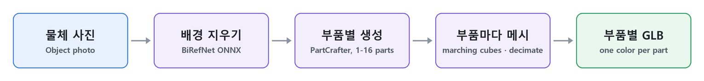

# PartCrafter — 이미지 → 부품별 3D

PromBoard 커뮤니티 플러그인입니다. 캔버스에 **PartCrafter 이미지 → 부품별 3D** 노드 하나를 더합니다. 물체 사진 한 장을 넣으면 부품(다리 · 몸통 · 손잡이 등)이 따로 나뉜 3D 메시를 GLB 하나로 만듭니다. 부품마다 색과 이름(part_00 …)이 달라 3D 프로그램에서 따로 고르고 고칠 수 있습니다. [PartCrafter](https://github.com/wgsxm/PartCrafter)(NeurIPS 2025)를 씁니다.



노드 안에서 일어나는 순서입니다(`docs/scripts/pipeline.py` 로 그림).

> 미검증: 이 플러그인은 아직 끝까지 돌려 보지 못했습니다(앱에 '검증 안 됨'으로 보입니다). 결과 그림은 실제로 돌려 본 뒤 넣습니다.

## 노드

- 입력: 물체 사진 한 장. 출력: 부품별 3D(GLB), 3D 보기로 돌려 볼 수 있습니다. 색 · 재질은 입히지 않고 부품마다 다른 색만 칠합니다.
- 부품 수: 1~16(기본 4). 물체의 실제 부품 수에 맞추면 잘 나뉩니다. 많을수록 그래픽카드 메모리와 시간이 늘어납니다.
- 부품마다 점 수: 512 · 1024(기본) · 2048
- 배경 지우기: 자동(투명 PNG 면 그 투명도, 아니면 BiRefNet) · 늘 BiRefNet · 안 함
- 면 수(전체): 5만 · 20만(기본) · 원본 그대로. 부품 크기에 맞춰 나눠 줄입니다.
- 단계 수(기본 50) · 그림 따르기(기본 7) · 시드

## 받는 것 · 크기

| 받는 것 | 크기 |
|---|---|
| PartCrafter 가중치([wgsxm/PartCrafter](https://huggingface.co/wgsxm/PartCrafter), MIT) | 3.97GB |
| BiRefNet ONNX([ZhengPeng7/BiRefNet 릴리스 v1](https://github.com/ZhengPeng7/BiRefNet/releases/tag/v1), MIT) — 배경 지우기가 '안 함'이 아닐 때 | 0.22GB |

플러그인 zip 에는 가중치가 없고, 실행 준비가 원래 출처에서 sha256 을 확인하며 받습니다.

## 알아 둘 것

- NVIDIA 그래픽카드(CUDA) 전용입니다. 윈도우 · 리눅스 잠금 파일만 넣었습니다(맥 없음). 그래픽카드 메모리는 8GB 이상으로 적었습니다(실측 아님).
- 공식 예제와 다른 점: 배경 지우기는 RMBG-1.4(비상업) 대신 BiRefNet(MIT), 파이프라인은 model_index.json(모듈 이름 `src.…`) 대신 부품을 하나씩 불러 조립, 부품 색은 무작위 대신 공식 팔레트 순서, 면 줄이기는 trimesh quadric 줄이기(fast-simplification, MIT)입니다.

## 라이선스

- 플러그인 코드: Apache-2.0([LICENSE](LICENSE), [NOTICE](NOTICE)). 담아 온 PartCrafter 코드 · 모델 가중치: MIT.
- 트랜스포머 코드 일부(`nodes/partcrafter/models/transformers/partcrafter_transformer.py`)는 Tencent HunyuanDiT 에서 왔고 [Tencent Hunyuan Community License](https://github.com/Tencent/HunyuanDiT/blob/main/LICENSE.txt)(2024-05-14판)를 따릅니다. 그래서 manifest license 는 "MIT AND Apache-2.0" 이고 앱은 설치 때 아래 조건을 보여 주고 확인을 받습니다.
  - EU 에서는 쓸 수 없습니다.
  - 다시 나눠 줄 때는 약관 사본과 Notice 문구를 함께 줍니다(그 파일 머리와 NOTICE 에 담았습니다).
  - 약관의 사용 제한(Acceptable Use Policy)을 지키고 받는 사람에게도 알립니다.
  - 그 판 공개일에 월 이용자가 1억 명을 넘던 회사는 Tencent 의 허락을 따로 받아야 합니다.

## 설치

1. PromBoard(앱 1.0.3 이상) → 플러그인 매니저 → 커뮤니티 플러그인 → 둘러보기에서 설치합니다.
2. 코드가 든 플러그인이라 제한 모드를 끄고 플러그인을 켭니다.
3. 처음 실행 전 실행 준비가 파이썬 패키지와 가중치(약 4.2GB)를 받습니다.
4. 캔버스 빈 곳을 오른쪽 클릭하면 메뉴 맨 아래 플러그인 묶음에 노드가 있습니다.

## 플러그인 만드는 사람을 위한 메모

```
manifest.json                  플러그인 정보 · 노드(layout single, views orbit3d) · 받는 모델
nodes/main.py                  NODES = {"image-to-parts": 함수} — 진행률 · 취소 · 메모리 부족 알림, 부품마다 이름 · 색을 단 GLB
nodes/cutout.py                BiRefNet ONNX 로 배경 지우기(onnxruntime)
nodes/partcrafter/             wgsxm/PartCrafter 의 src(추론 부분, 바꾼 곳은 NOTICE)
nodes/requirements-*.txt       파이썬 패키지 잠금 파일(torch 는 앱이 고정한 2.8.0)
docs/scripts/                  README 그림 만드는 스크립트(GLB → three.js 렌더 · 움짤). 플러그인 zip 에는 넣지 않는다
```

---

## English

A PromBoard community plugin. It adds one **PartCrafter image → 3D parts** node: give it one photo of an object and it writes one GLB whose mesh is split into parts (legs, body, handle, ...). Each part has its own color and name (part_00 ...) so it can be selected and edited separately in 3D tools. It uses [PartCrafter](https://github.com/wgsxm/PartCrafter) (NeurIPS 2025).


What happens inside the node, in order (drawn by `docs/scripts/pipeline.py`).

> Not verified: this plugin has not been run end to end yet (the app shows it as unverified). Result images will be added after a real run.

- Input: one object photo. Output: 3D parts (GLB) with an orbit 3D view; no material, one color per part.
- Settings: number of parts (1–16, default 4; matching the object's real parts works best, more parts need more GPU memory and time), tokens per part (512 · 1024 default · 2048), background removal (auto · always BiRefNet · off), total face count (50K · 200K default · original, split by part size), steps (50), image guidance (7), seed.
- Downloads: PartCrafter weights ([wgsxm/PartCrafter](https://huggingface.co/wgsxm/PartCrafter), MIT, 3.97 GB) and, unless background removal is off, the BiRefNet ONNX model (GitHub release v1, MIT, 0.22 GB). They are not in the zip and are checked by sha256.
- NVIDIA GPUs (CUDA) only; lock files for Windows and Linux (no macOS). GPU memory is listed as 8 GB (not measured).
- Differences from the official example: BiRefNet (MIT) instead of RMBG-1.4 (non-commercial), the pipeline is assembled from its components instead of model_index.json (module names `src.…`), part colors follow the official palette instead of random colors, and trimesh quadric decimation (fast-simplification, MIT) reduces faces.
- Plugin code is Apache-2.0; the bundled PartCrafter code and the weights are MIT. Part of the transformer code comes from Tencent HunyuanDiT and is under the [Tencent Hunyuan Community License](https://github.com/Tencent/HunyuanDiT/blob/main/LICENSE.txt) (2024-05-14): it may not be used in the EU, redistribution must include the agreement and its Notice text (both are in that file's header and in NOTICE), the Acceptable Use Policy applies and must be passed on, and companies with more than 100 million monthly active users on that release date need a separate license from Tencent. The app shows these conditions and asks for confirmation at install time.
- Install: PromBoard (app 1.0.3 or later) → Plugin Manager → Community plugins → Browse → install, turn off Restricted mode and enable the plugin. The first prepare downloads the Python packages and weights (about 4.2 GB).

The plugin texts in the app are Korean only for now (the manifest takes a single language).
